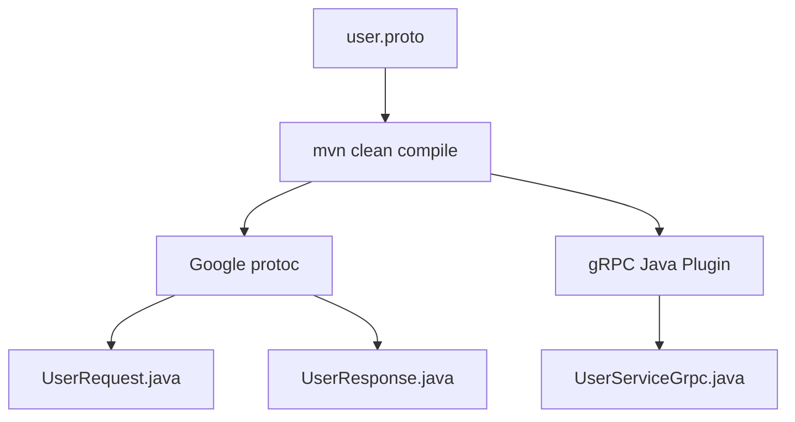
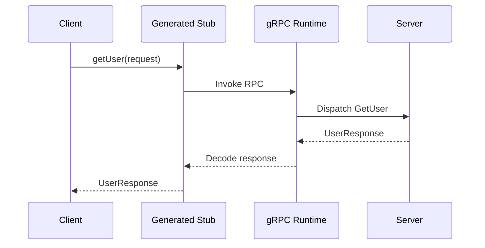

# Understanding RPC (gRPC)

##  What is RPC? 
**RPC** stands for Remote Procedure Call. 

It is a communication model that allows one application to invoke a procedure or method running in another process, potentially on another machine.

Consider two services:
- **User Client:** Needs to retrieve user information.
- **User Server:** Owns the user information and exposes an operation to retrieve it.

With REST, we might communicate through an HTTP endpoint:

```java
GET /users/101
```
Using Spring's RestClient:
```java
User user = restClient.get()
    .uri("/users/{id}", 101)
    .retrieve()
    .body(User.class);
```

With an RPC framework such as gRPC, the invocation looks like:
```java
UserResponse user = stub.getUser(request);
```
---

Although this resembles a local method call, the actual method executes in another application.


> **RPC abstracts remote invocation; it does not eliminate networking, latency, or network failures.**

> **RPC is the general concept. gRPC is one implementation of RPC.**
---

## Protocol Buffers: Our API Contract

With gRPC, we usually begin by defining a `.proto` file.

Think of this as similar in purpose to an OpenAPI specification: it describes the operations available and the messages exchanged.

You write a `.proto` file that describes your service methods and data structures:

```protobuf
syntax = "proto3";

option java_multiple_files = true;
option java_package = "com.example.grpc";

service UserService {
    rpc GetUser(UserRequest) returns (UserResponse);
}

message UserRequest {
    int32 id = 1;
}

message UserResponse {
    int32 id = 1;
    string name = 2;
}
```

This contracts defines: 
- `UserService` : The remote service. 
- `GetUser` : The RPC method exposed by the service 
- `UserRequest` : The request message containing a user ID. 
- `UserResponse` : The response message containing user details. 

> The field numbers (1, 2) are Protobuf field identifiers used in binary encoding, not default values.
> These are used for serialization and deserialization. 

## gRPC Stub 

> A stub is a **generated client-side proxy for a remote service**.

- The client calls the method on the stub, and the stub works with the gRPC runtime to invoke the corresponding method on the server.


- The flow looks like: 



